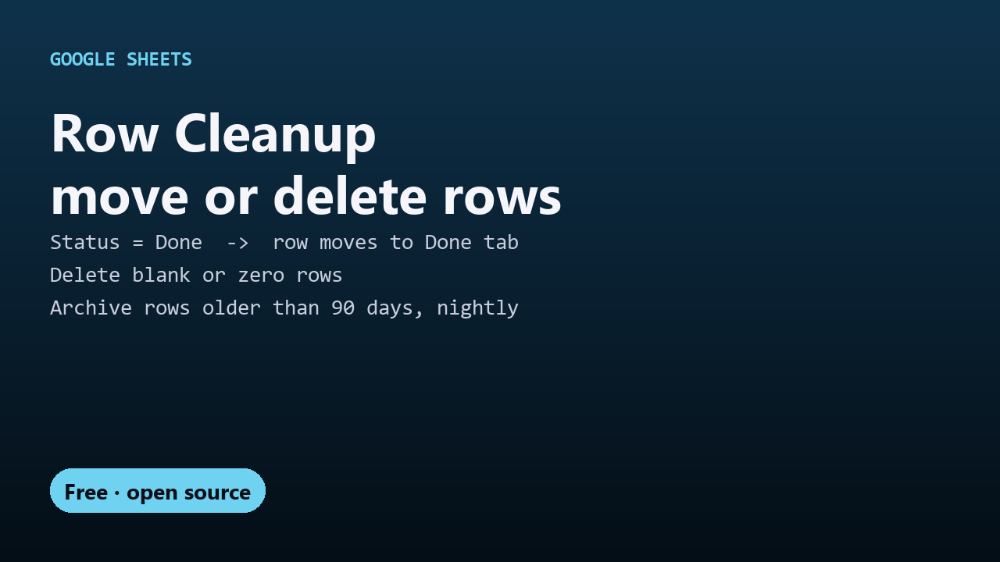

# Free Row Cleanup for Google Sheets: move or delete rows automatically



Move a row to another tab the moment its Status becomes "Done". Delete rows where a column is blank or 0. Archive anything older than 90 days, every night. One free script, no add-on.

```js
const RULES = [
  { tab: 'Tasks', column: 'D', when: 'equals:Done',   action: 'move:Done' },
  { tab: 'Leads', column: 'B', when: 'blank',         action: 'delete' },
  { tab: 'Log',   column: 'A', when: 'older than:90', action: 'move:Archive' },
];
```

- **Conditions:** `blank`, `zero`, `checked` (a ticked checkbox), `equals:…`, `contains:…` (both ignore case), `older than:N` days, `always`
- **Actions:** `delete`, `move:Tab name` (the tab is created with your header row if it doesn't exist), or `clear:B:F` to empty those columns and keep the row, e.g. a nightly reset of a daily checklist
- **Instant** for `equals`, `contains` and `checked` rules: the row moves as soon as someone sets the cell
- **🧹 Cleanup → Run Cleanup Now**, or **Run Daily** to run every rule every night

New to this? Read the [step-by-step guide](https://decodedxr.github.io/sheets-row-cleanup/move-or-delete-rows-google-sheets.html).

## Setup (3 minutes)

1. In your sheet: **Extensions → Apps Script**.
2. Replace `Code.gs` with this repo's `Code.gs`.
3. Edit `RULES` at the top for your tabs and columns, and click **Save**. Reload the sheet to get the **🧹 Cleanup** menu.
4. The first time you use the menu, approve the permission prompt ("Google hasn't verified this app" → **Advanced → Go to (your project name) → Allow**; it's your own script).

## Things to know

- **Try it on a copy first** (**File → Make a copy**). Deleted rows can be brought back with **Edit → Undo** or **File → Version history**, but a copy is easier.
- Instant mode never runs `blank` or `zero` rules, so clearing a cell to retype it doesn't delete the row. Those rules run from the menu or the nightly run.
- Moved rows keep their values but not their formatting, checkboxes or formulas (formulas arrive as their results).
- `HEADER_ROWS` (default 1) protects the header. Set `ON_EDIT = false` to only clean up from the menu or the nightly run.
- Instant moves happen for edits made by people. Rows added by Google Forms or other scripts are handled by the nightly run.

## More free Google tools

- [All free Google Sheets scripts](https://github.com/DecodedXR/free-google-sheets-scripts): mail merge, PDF merge, reminders, Sheets to Calendar, CSV import, Forms tools, dropdowns, timestamps, count by color.

## License

MIT. See `LICENSE`.
